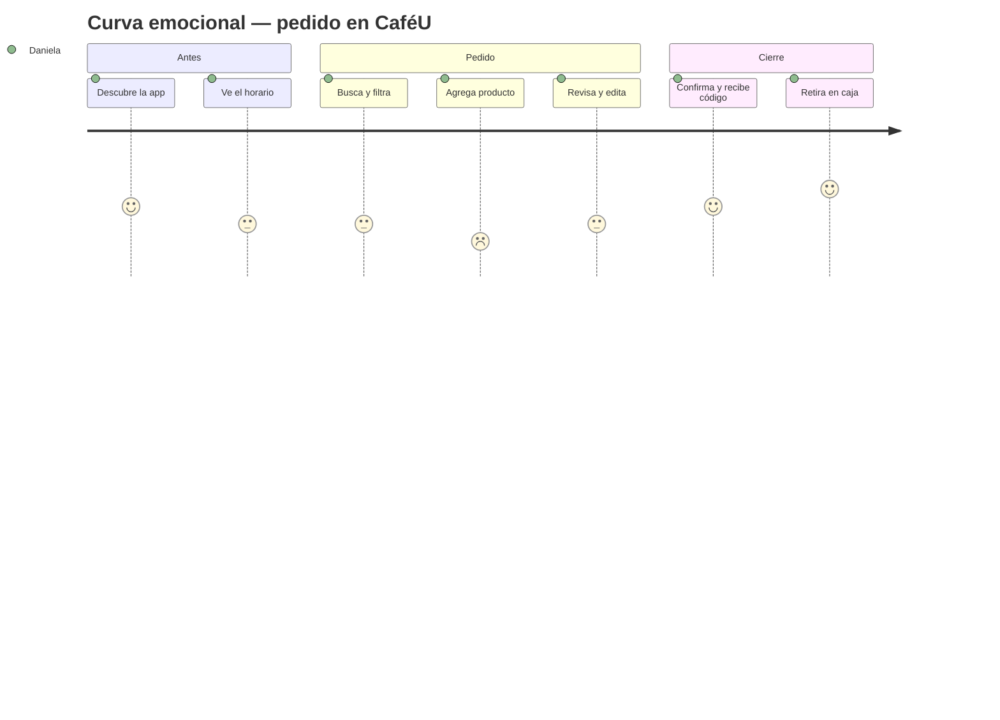

# Análisis de usuario y experiencia — CaféU 2.0

**Actividad 1 · Responsable: Kevin Velasco**
**Evidencia que respalda este documento:** observaciones de P1–P3 y evaluación heurística de los 4 integrantes realizadas en la materia (`Sax300-cpu/HCI-2026-G2`, carpeta `ape6/Fase3-4/`). Los hallazgos `H-01…H-09` y sus severidades se toman de ahí; no se inventan datos nuevos.

---

## 1. Persona usuaria

| Campo | Descripción |
| :--- | :--- |
| **Nombre (ficticio)** | Daniela, 20 años |
| **Perfil** | Estudiante de 5.º semestre de la UTA (perfil coincidente con los participantes P1–P3: estudiantes UTA, ajenos al diseño, mayores de edad) |
| **Dispositivo** | Celular, a una mano; a veces con la otra mano cargando cuadernos o mochila |
| **Experiencia digital** | Alta en redes y apps de delivery; baja paciencia con interfaces que obligan a recordar pasos |
| **Meta** | Pedir un café y algo de comer entre clases sin hacer fila y retirarlo rápido |
| **Frustraciones** | No saber si el producto se agregó; equivocarse al quitar algo; perder el pedido por un toque accidental; buscar «cafe» y no encontrar «Café» |
| **Motivación** | Aprovechar los 15–20 min de receso |

### Contexto de interacción
- **Dónde:** pasillos y patio de la facultad, con luz solar fuerte (afecta el contraste) y ruido.
- **Cuándo:** receso corto, con presión de tiempo.
- **Cómo:** pantalla pequeña, atención dividida, a menudo de pie y en movimiento.
- **Qué necesita el sistema:** mensajes visibles, controles grandes, recuperación fácil de errores, confirmación clara del pedido.

---

## 2. Touchpoints (recorrido del servicio)

| # | Touchpoint | Canal | Qué hace la persona | Emoción esperada |
| :---: | :--- | :--- | :--- | :---: |
| 1 | Descubrir la app (cartel/compañeros) | Físico/social | Se entera de que puede pedir sin fila | Curiosidad |
| 2 | Pantalla de inicio (horario) | App | Verifica si la cafetería está abierta | Neutral |
| 3 | Menú: catálogo y búsqueda | App | Busca un producto, filtra por categoría | Interés / duda |
| 4 | Agregar al pedido | App | Pulsa «Agregar» y espera una señal | Expectativa |
| 5 | Mi pedido: cantidades y quitar | App | Revisa, cambia cantidad, elimina | Control / tensión |
| 6 | Confirmación y código de retiro | App | Confirma y recibe el código #CU-xxx | Alivio |
| 7 | Retiro en caja | Físico | Muestra el código y recoge | Satisfacción |

## 3. Momentos de verdad

| MdV | Momento | Por qué es decisivo | Riesgo observado |
| :---: | :--- | :--- | :--- |
| **MdV-1** | **Agregar un producto** (touchpoint 4): ¿se agregó o no? | Si la persona duda, repite el toque o abandona | 2 de 3 participantes no percibieron el aviso (H-01) |
| **MdV-2** | **Confirmar el pedido y recibir el código** (touchpoint 6) | Es el cierre de la tarea; un fallo aquí destruye la confianza en el servicio | Código no copiable (H-05), salir de la pantalla borra el pedido (H-03), motivo del bloqueo de «Confirmar» poco visible (H-04) |

---

## 4. Curva emocional

Escala: 5 = muy positiva · 3 = neutral · 1 = muy negativa. Refleja el recorrido típico de Daniela con las fricciones observadas en v2.

| Touchpoint | 1 | 2 | 3 | 4 | 5 | 6 | 7 |
| :--- | :-: | :-: | :-: | :-: | :-: | :-: | :-: |
| Emoción | 4 | 3 | 3 | 2 | 3 | 4 | 5 |
| Causa del cambio | Promesa de ahorrar tiempo | Información útil, sin sorpresa | Búsqueda sin resultados confunde (H-02) | No sabe si agregó (H-01) | Quitar es claro, pero editar el ítem no es obvio (H-08) | Recibe el código | Retira sin fila |

**Punto más bajo:** touchpoint 4 (agregar), coincide con MdV-1. **Oportunidad:** confirmación visible y persistente del agregado.

---

## 5. Matriz de problemas ↔ Nielsen ↔ Gestalt

Severidad 0–4 (Nielsen). Origen: matriz consolidada de la evaluación (`ape6/Fase3-4/docs/matriz-consolidada.md`).

| ID | Problema | Heurística de Nielsen | Principio de Gestalt | Sev. | Touchpoint |
| :---: | :--- | :--- | :--- | :---: | :---: |
| H-01 | Aviso «agregado» efímero y poco contrastado | N1 · Visibilidad del estado del sistema | **Figura-fondo**: el aviso no se destaca del fondo | 3 | 4 |
| H-02 | Búsqueda sin resultados, sin salida | N9 · Recuperación de errores | **Cierre**: el estado vacío no completa el mensaje con una acción | 3 | 3 |
| H-03 | Salir de la confirmación borra el pedido | N3 · Control y libertad del usuario | **Continuidad**: el flujo se corta sin aviso | 2 | 6 |
| H-04 | Motivo del bloqueo lejos del botón | N5 · Prevención de errores | **Proximidad**: causa y botón no están agrupados | 2 | 6 |
| H-05 | Código de retiro no copiable ni explicado | N10 · Ayuda y documentación | **Similitud / énfasis**: el dato clave no se distingue como acción | 2 | 6 |
| H-06 | Contador del carrito sin unidad ni etiqueta | N2 · Relación sistema–mundo real | **Proximidad**: número sin su etiqueta | 1 | 4 |
| H-07 | Sin indicador de pasos | N1 · Visibilidad del estado | **Continuidad**: no se percibe el camino completo | 1 | 3–6 |
| H-08 | El ítem del pedido no es tocable (el del menú sí) | N4 · Consistencia y estándares | **Similitud**: elementos parecidos se comportan distinto | 2 | 5 |
| H-09 | El total no se ve desde el menú | N6 · Reconocer antes que recordar | **Proximidad / región común**: total lejos de donde se decide | 1 | 3 |

### Lectura
- Los tres problemas de mayor impacto (H-01, H-02 con severidad 3) caen en **MdV-1** y en la **búsqueda**, donde la persona decide si continúa.
- Nielsen N1 (visibilidad del estado) aparece dos veces: la app debe «hablar» más claramente.
- Estos hallazgos alimentan los requisitos (Actividad 2), la planificación de pruebas (Actividad 4) y el backlog (Actividad 7).

---

## 6. Limitaciones
- La persona es una síntesis de estudiantes UTA; no es un estudio estadístico.
- La curva emocional es **cualitativa**, construida con observaciones y comentarios en voz alta de 3 participantes; no sustituye a nuevas sesiones con P00/P01/P02 de esta prueba.
- Si el equipo repite sesiones con otros participantes, esta curva debe actualizarse con esos datos reales.
